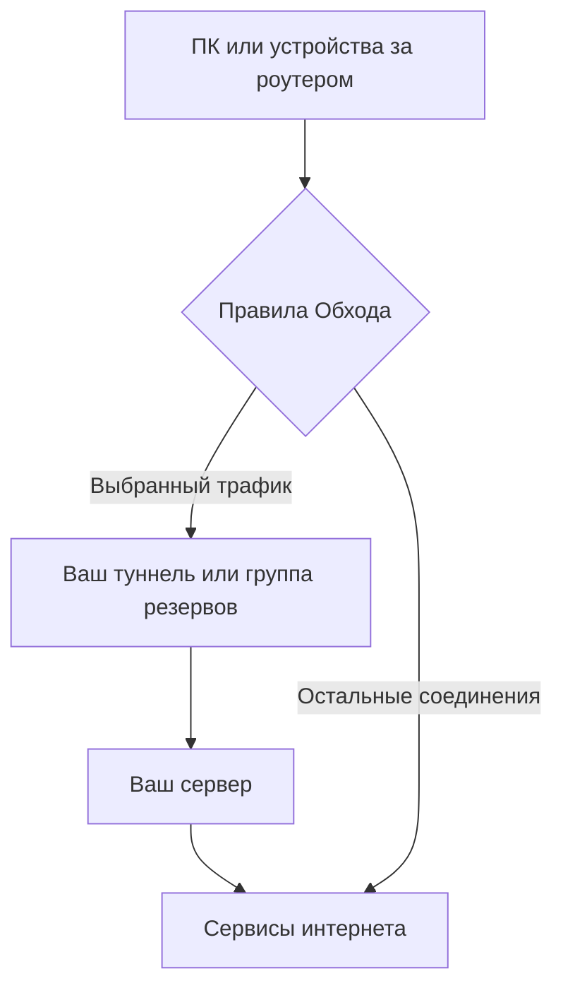

<p align="center">
  
</p>

# Обход

**Выборочная маршрутизация для Windows и OpenWrt.** Направляйте выбранные сайты,
подсети и, на Windows, программы через свои подключения. Остальной трафик
сохраняет обычный маршрут. Несколько серверов можно объединить в группу резервов.

Этот репозиторий содержит готовые установщики, пакеты и файлы обновлений.
[Исходники и полная документация](https://github.com/Ktoto59/obhod-source)
публикуются отдельно.

## Скачать и настроить

| Платформа | Загрузка | Пошаговое руководство |
| --- | --- | --- |
| **Windows 10/11 x64** | [Установщик Windows](https://github.com/Ktoto59/obhod-releases/releases/latest) | [Установка, настройка и использование](https://github.com/Ktoto59/obhod-source/blob/main/windows/README.md) |
| **OpenWrt 24.10/25.12** | [Комплект OpenWrt 0.1.16](https://github.com/Ktoto59/obhod-releases/releases/tag/openwrt-v0.1.16) или [онлайн-установка](openwrt/README.md#установка) | [Установка, LuCI, DNS и диагностика](https://github.com/Ktoto59/obhod-source/blob/main/openwrt/README.md) |

Ссылка **Latest** относится к Windows. OpenWrt публикуется отдельными
предварительными релизами с тегами `openwrt-v…`.

## Для чего нужен Обход

Обход помогает задать отдельный маршрут для рабочих ресурсов и выбранных
сервисов, сохранив прямое подключение к остальному интернету и локальной сети.
Правила, подключение и диагностика собраны в одном интерфейсе.
На Windows настройки действуют на один ПК; на OpenWrt — на устройства,
использующие роутер как шлюз и DNS-сервер.

Получите свои настройки у провайдера либо администратора: `.conf`, ссылку
подключения или V2Ray-подписку. Готовые аккаунты, ключи и подписки в поставку
не включены. Установка Windows-приложения для использования роутера не требуется.



Все серверы группы используют один набор правил. Автовыбор не суммирует скорости
и не гарантирует сохранения уже установленной сессии при отказе сервера.

## Windows: быстрый старт

1. Откройте [релиз Windows](https://github.com/Ktoto59/obhod-releases/releases/latest)
   и скачайте `Obhod-Setup-<версия>.exe` из **Assets**.
2. Установите приложение и откройте Обход. Для TUN нужны права администратора.
   Сетевое ядро уже включено в установщик.
3. В **Подключения** импортируйте `.conf` либо нажмите **Вставить ссылку**.
   Для URL подписки выберите **Подписка V2Ray**.
4. В **Сайты и приложения** выберите готовые наборы или добавьте свои домены/подсети.
5. Сохраните настройки и включите маршрутизацию на **Главной**.


Поддерживаются WireGuard, AmneziaWG, VLESS/Reality, Shadowsocks, Trojan,
Hysteria2, TUIC, AnyTLS, SOCKS5 и HTTP(S). Доступны TUN, системный и локальный
прокси, правила программ, DNS и резервные подключения.

- [Импорт и подключение](https://github.com/Ktoto59/obhod-source/blob/main/windows/README.md#подключения-и-импорт).
- [Свои сайты, подсети и программы](https://github.com/Ktoto59/obhod-source/blob/main/windows/README.md#сайты-подсети-и-программы).
- [Режимы и DNS](https://github.com/Ktoto59/obhod-source/blob/main/windows/README.md#режимы-подключения).
- [Резервные подключения](https://github.com/Ktoto59/obhod-source/blob/main/windows/README.md#резервные-подключения).
- [Резервная копия и перенос](https://github.com/Ktoto59/obhod-source/blob/main/windows/README.md#резервная-копия-и-перенос).
- [Диагностика и решение проблем](https://github.com/Ktoto59/obhod-source/blob/main/windows/README.md#диагностика-и-решение-проблем).

## OpenWrt: быстрый старт

Подключитесь к своему роутеру по SSH от `root` и выполните:

```sh
wget -O /tmp/obhod-install.sh https://raw.githubusercontent.com/Ktoto59/obhod-releases/main/openwrt/install.sh && sh /tmp/obhod-install.sh
```

Установщик определяет `apk` или `opkg`, проверяет место, подготавливает зависимости
и предлагает выбрать ядро и начальные списки. Затем:

1. Откройте **LuCI → Службы → Обход**.
2. В **Протоколы** установите ядро, если отложили этот шаг при установке.
3. В **Подключения** импортируйте свои настройки и выберите сервер.
4. Задайте **Правила**, проверьте LAN-интерфейс и управление DNS во вкладке **Сеть**.
5. Нажмите **Сохранить и включить**, затем выполните проверку в **Диагностика**.


Клиентские устройства должны использовать этот роутер как шлюз и DNS.
Для прокси доступно облегчённое ядро, для WireGuard нужно полное.
AmneziaWG в текущем пакете OpenWrt не поддерживается.

- [Совместимость и память](https://github.com/Ktoto59/obhod-source/blob/main/openwrt/README.md#совместимость-и-требования).
- [Установка и первый запуск](openwrt/README.md).
- [Домены, подсети и списки](https://github.com/Ktoto59/obhod-source/blob/main/openwrt/README.md#домены-подсети-и-списки).
- [DNS и FakeIP](https://github.com/Ktoto59/obhod-source/blob/main/openwrt/README.md#dns-и-fakeip).
- [Выбор и обновление ядра](https://github.com/Ktoto59/obhod-source/blob/main/openwrt/README.md#установка-и-обновление-ядра).
- [Обновление самого Обхода](https://github.com/Ktoto59/obhod-source/blob/main/openwrt/README.md#обновление-обхода).
- [Диагностика и журнал](https://github.com/Ktoto59/obhod-source/blob/main/openwrt/README.md#диагностика-и-журнал).

## Изображения и схемы

В [полных руководствах](https://github.com/Ktoto59/obhod-source) есть
16 скриншотов и отдельные схемы Windows, OpenWrt и DNS/FakeIP. Изображения
показывают реальные интерфейсы на демонстрационных данных. Адреса, подписка,
IP и задержки служат примерами, а не действующими подключениями или замерами.
Подробная документация и изображения хранятся в репозитории исходников,
чтобы исправления были доступны из одного места.

## Обновления и исходники

Обновления Windows доступны через **Настройки → Обновления** либо установку
нового `Setup`. На OpenWrt используйте **Обзор → Обновления Обхода**;
сетевое ядро обновляется отдельно во вкладке **Протоколы**.
Перед заменой настроек сохраните резервную копию.

[Исходный код](https://github.com/Ktoto59/obhod-source),
[лицензии компонентов](https://github.com/Ktoto59/obhod-source/blob/main/THIRD_PARTY_NOTICES.md)
и [инструкции сборки](https://github.com/Ktoto59/obhod-source#исходники-и-разработка)
находятся в репозитории разработки. Изменения конкретной версии описаны на странице её релиза.
