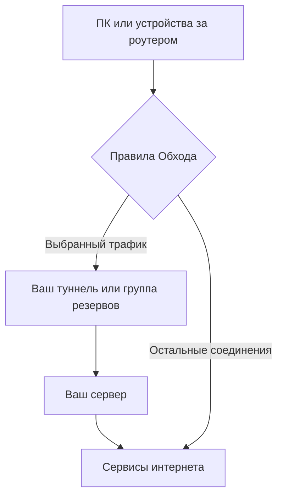

<p align="center">
  
</p>

# Обход — готовые версии

**Нужные сайты и приложения — через ваше подключение. Остальной трафик — напрямую.**

Обход помогает управлять сетевыми маршрутами на компьютере и домашнем роутере.
Вы добавляете свои серверы, выбираете домены, подсети или программы и включаете
маршрутизацию. Несколько подключений можно использовать как резерв друг для друга.

## Скачать

| Windows | OpenWrt |
| --- | --- |
| **[Скачать установщик Windows](https://github.com/Ktoto59/obhod-releases/releases/latest)** | **[Скачать комплект OpenWrt](https://github.com/Ktoto59/obhod-releases/releases/tag/openwrt-v0.1.18)** |
| Windows 10/11, x64 | OpenWrt 24.10 / 25.12 |
| Файл `Obhod-Setup-<версия>.exe` в разделе Assets | Онлайн-установщик или комплект `.tar.gz` |
| [Установить на компьютер](#windows-установка-и-первый-запуск) | [Установить на роутер](#openwrt-установка-и-первый-запуск) |

**Latest — канал Windows.** Сборки OpenWrt публикуются отдельно с тегами
`openwrt-v…` и пометкой предварительной версии. Состав изменений и файлы каждой
версии находятся на [странице релизов](https://github.com/Ktoto59/obhod-releases/releases).

[Возможности](#что-умеет-обход) · [Схема работы](#как-это-работает) ·
[Обновление](#как-обновляться) · [Частые вопросы](#частые-вопросы) ·
[Инструкции](#подробные-инструкции)

## Какой вариант выбрать

**Windows** — если маршрут нужен на одном компьютере. Можно выбирать сайты,
подсети и отдельные программы, пользоваться TUN или локальным прокси.

**OpenWrt** — если маршрутизацией должен управлять роутер: например, для
телефона, телевизора и нескольких компьютеров. Настройка выполняется в LuCI;
клиентские устройства используют этот роутер как шлюз и DNS-сервер.
Устанавливать Windows-приложение на них не требуется.

Оба варианта используют ваши подключения. До настройки получите у провайдера
или администратора **файл `.conf`, ссылку подключения или V2Ray-подписку**.
Готовые пользовательские аккаунты и ключи в поставку не включены.

## Что умеет Обход

| Возможность | Windows | OpenWrt |
| --- | --- | --- |
| Правила для доменов, IP и подсетей | Да | Да |
| Готовые наборы сайтов и свои списки | Да | Да |
| Импорт ссылок и V2Ray-подписок | Да | Да |
| WireGuard | Да | С полным ядром |
| AmneziaWG | Да | Пока не поддерживается |
| VLESS/Reality, Shadowsocks, Trojan, Hysteria2, TUIC, AnyTLS, SOCKS5, HTTP(S) | Да | Зависит от установленного ядра |
| Автовыбор и резервные серверы | Да | Да |
| Правила отдельных программ | Да, в TUN | Правила действуют на трафик локальной сети |
| DNS и диагностика маршрута | В приложении | В LuCI, включая DNS-группы и FakeIP |

## Как это работает



Все серверы группы используют **одни общие правила**. Автовыбор проверяет
соединения HTTPS-запросом и выбирает рабочий маршрут. Чувствительность
переключения настраивается. Скорости серверов не складываются; при отказе
сервера уже установленный звонок или загрузка могут прерваться.

## Windows: установка и первый запуск

1. Откройте [релиз Windows](https://github.com/Ktoto59/obhod-releases/releases/latest).
2. В **Assets** скачайте `Obhod-Setup-<версия>.exe`. Архивы исходников,
   `.blockmap` и `latest.yml` для ручной установки не нужны.
3. Запустите установщик, выберите каталог и завершите установку.
4. Откройте **Обход** и подтвердите запрос Windows на повышение прав.
5. Пройдите мастер: **Подключение → Правила → Проверка**. Либо настройте
   приложение вручную по шагам ниже.

Сетевое ядро уже входит в установщик. Для TUN требуются права администратора.


### Добавить подключение

Откройте **Подключения**:

- Для WireGuard/AmneziaWG нажмите **Импорт .conf** и выберите выданный файл.
- Для одной ссылки нажмите **Вставить ссылку → Одно подключение**.
- Для подписки выберите **Вставить ссылку → Подписка V2Ray** и вставьте её URL,
  список ссылок или Base64-представление списка.

Проверьте подключение кнопкой **Проверить**. URL подписки не сохраняется;
для получения новых серверов импорт повторяется вручную.

### Выбрать сайты и включить

В **Сайты и приложения** отметьте нужные готовые наборы либо нажмите
**+ Добавить сайт** и создайте свой список. Домены вводятся по одному в строке:

```text
example.com
docs.example.org
```

Это демонстрационные домены: замените их адресами нужных сервисов.
Правило действует на домен и его поддомены. Сохраните список и изменения
страницы, затем нажмите большую кнопку **ПУСК** на **Главной**.

Для резерва откройте **Настройки → Автовыбор**, отметьте минимум два рабочих
сервера и сохраните. Для одного фиксированного сервера выключите автовыбор
и выберите основное подключение.

**[Полное руководство Windows со скриншотами →](https://github.com/Ktoto59/obhod-source/blob/main/windows/README.md)**

## OpenWrt: установка и первый запуск

Нужны установленная OpenWrt, LuCI, SSH-доступ от `root`, доступ в интернет
и свободное место для ядра. Установщик показывает ОЗУ, flash и `/tmp`,
подготавливает зависимости и определяет `apk`/`opkg` автоматически.
Обычная заводская прошивка роутера не подходит.

1. Подключитесь к **своему** роутеру по SSH, заменив адрес в примере:

```sh
ssh root@192.168.1.1
```

2. В терминале роутера выполните:

```sh
wget -O /tmp/obhod-install.sh https://raw.githubusercontent.com/Ktoto59/obhod-releases/main/openwrt/install.sh && sh /tmp/obhod-install.sh
```

3. Выберите ядро и начальные списки. Для прокси доступно облегчённое ядро,
   для WireGuard требуется полное. Установку ядра можно отложить до настройки LuCI.
4. Откройте **LuCI → Службы → Обход**. Если меню не появилось, обновите страницу.
5. Во вкладке **Подключения → Добавить подключения** вставьте свои параметры:
   ссылку, подписку или текст WireGuard `.conf`. Выберите основной сервер.
6. В **Правила** добавьте нужные домены/подсети или готовые наборы.
7. В **Сеть** проверьте входящий интерфейс, обычно `br-lan`, и управление DNS.
8. Нажмите **Сохранить и включить**, затем **Диагностика → Проверить работоспособность**.


На телефоне или ПК **шлюз и DNS должны указывать на этот роутер**.
Работающий VPN либо собственный защищённый DNS клиента могут изменить
результат проверки. После чистой установки Обход выключен до добавления
подключения и явного запуска.

Внешние списки OpenWrt загружаются как `.srs` или JSON rule-set sing-box;
обычный текст вставляйте в свои домены/подсети. Для нескольких DNS-серверов
во вкладке **Сеть** доступны автоматический и параллельный опрос.
Не смешивайте в одной группе разные политики фильтрации без необходимости.

**[Полное руководство OpenWrt со скриншотами →](https://github.com/Ktoto59/obhod-source/blob/main/openwrt/README.md)**

Для ручного переноса комплекта, проверки свободного места и установки на
роутер без прямого доступа к загрузкам откройте [инструкцию установки](openwrt/README.md).

## Как обновляться

| Платформа | Обновление приложения | Сетевое ядро |
| --- | --- | --- |
| Windows | **Настройки → Обновления** или новый `Obhod-Setup-<версия>.exe` | Входит в состав установщика Windows |
| OpenWrt | **Обзор → Обновления Обхода** в LuCI | Отдельно: **Протоколы**, выключить службу, выбрать сборку и установить |

Перед обновлением сохраните изменения и резервную копию. В Windows она
создаётся через **Настройки → Перенос настроек**. Для OpenWrt копируются
файлы профиля; порядок описан в [руководстве](https://github.com/Ktoto59/obhod-source/blob/main/openwrt/README.md#резервная-копия).

Обновление самого Обхода через LuCI доступно с 0.1.5. С более ранней версии
один раз запустите обычный установщик. При смене ядра сохраняйте нужный набор:
для WireGuard полное ядро требуется и после обновления приложения.

## Частые вопросы

**Обход предоставляет серверы?**
Подключения добавляете вы: используйте настройки своего сервера или провайдера.

**Весь интернет пойдёт через сервер?**
Через подключение направляется трафик, выбранный правилами. Остальные соединения
используют прямой маршрут. В режиме TUN перехват приложений не означает выбор
всего их трафика для удалённого сервера.

**Для работы через роутер нужно запускать приложение на ПК?**
Нет. Достаточно правильно настроить роутер и использовать его как шлюз и DNS.
Windows-приложение управляет маршрутизацией отдельно на компьютере.

**Добавил сайт, но его внешний IP не изменился. Что проверить?**
Сохранение правила, точный домен, выбранный маршрут и новое соединение браузера.
На OpenWrt дополнительно проверьте шлюз и DNS клиента. `2ip.io` и `2ip.ru` —
разные домены: добавление одного не добавляет другой.

**Работают сайты, но обрывается звонок.**
Проверьте UDP через выбранный протокол и сервер, качество Wi-Fi и переключения
маршрута. Успешная HTTPS-проверка сама по себе не проверяет качество UDP-звонка.

**Где посмотреть ошибку?**
Windows: **Помощь → Открыть журнал → Проверить DNS/маршрут**.
OpenWrt: **Диагностика → Проверить работоспособность**, затем журнал службы.
Журнал OpenWrt ограничен и хранится в ОЗУ. При обращении укажите версии,
протокол, время события и результат проверки; пароли и подписки публиковать не нужно.

## Подробные инструкции

- **[Windows: установка, DNS, программы, резервирование и перенос](https://github.com/Ktoto59/obhod-source/blob/main/windows/README.md)**.
- **[OpenWrt: совместимость, LuCI, ядра, FakeIP и диагностика](https://github.com/Ktoto59/obhod-source/blob/main/openwrt/README.md)**.
- [Схема работы Windows](https://github.com/Ktoto59/obhod-source/blob/main/windows/README.md#как-устроена-работа-приложения).
- [Схемы службы и DNS на OpenWrt](https://github.com/Ktoto59/obhod-source/blob/main/openwrt/README.md#как-устроена-работа-службы).

В руководствах есть дополнительные скриншоты. Изображения показывают настоящие
интерфейсы на демонстрационных данных: адреса, подписки, IP и задержки служат
примерами. Подробные инструкции и иллюстрации поддерживаются в одном месте,
чтобы они оставались одинаковыми для пользователей обеих страниц загрузки.

## О репозитории

Здесь публикуются готовые версии Обхода и файлы автоматического обновления.
Изменения каждой сборки описаны на её странице в **Releases**.
[Исходники, лицензии и инструкции сборки](https://github.com/Ktoto59/obhod-source)
находятся в отдельном репозитории разработки.
